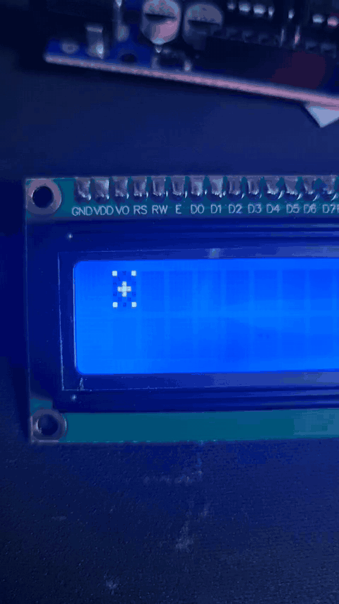

# Arduino-LCD1602-Animation
Arduino LCD1602 Custom Character Animation

<회로도>


<아이콘 디자인>


<코드 스케치>
```cpp
#include <LiquidCrystal_I2C.h>

LiquidCrystal_I2C lcd(0x27, 16, 2);

// 0. 초기 알
byte c0[] = {
  B00000, B00100, B01110, B11111,
  B11111, B11111, B01110, B00000
};

// 1. 작은 금
byte c1[] = {
  B00000, B00100, B01010, B11111,
  B11111, B11111, B01110, B00000
};

// 2. 금이 퍼짐
byte c2[] = {
  B00000, B00100, B01010, B11011,
  B10111, B11111, B01110, B00000
};

// 3. 깨지기 직전
byte c3[] = {
  B00000, B00100, B01010, B10001,
  B10101, B11011, B01110, B00000
};

// 4. 껍질이 깨짐
byte c4[] = {
  B10101, B01010, B10001, B00100,
  B10001, B01010, B10101, B00000
};

// 5. 껍질 파편
byte c5[] = {
  B10001, B00000, B00100, B01110,
  B00100, B00000, B10001, B00000
};

// 6. 계란 후라이
byte c6[] = {
  B00000, B00000, B01110, B11011,
  B10101, B11011, B01110, B00000
};

// 애니메이션 순서 (c6 두 번 출력)
byte animation[] = {0, 1, 2, 3, 4, 5, 6, 6};

byte frame = 0;
unsigned long previousMillis = 0;

// 프레임 속도 설정
const unsigned long interval = 200;

void setup() {
  lcd.init();
  lcd.backlight();
  lcd.clear();

  // Custom Character 등록
  lcd.createChar(0, c0);
  lcd.createChar(1, c1);
  lcd.createChar(2, c2);
  lcd.createChar(3, c3);
  lcd.createChar(4, c4);
  lcd.createChar(5, c5);
  lcd.createChar(6, c6);

  // 첫째 줄 첫 번째 칸에 출력
  lcd.setCursor(0, 0);
  lcd.write((byte)0);
}

void loop() {
  unsigned long currentMillis = millis();

  if (currentMillis - previousMillis >= interval) {
    previousMillis = currentMillis;

    frame = (frame + 1) % 8;

    lcd.setCursor(0, 0);
    lcd.write(animation[frame]);
  }
}
```

<데모>



<설명>

이 코드는 아두이노와 LCD1602의 Custom Character 기능을 활용하여 알이 깨지고 계란 후라이가 나타나는 애니메이션을 구현한 프로그램입니다.
c0부터 c6까지 총 7개의 사용자 정의 캐릭터를 만들어 알에 금이 가고, 껍질이 깨진 후 계란 후라이가 나타나는 과정을 표현했습니다.
setup()에서는 LCD를 초기화하고 캐릭터를 등록하며, loop()에서는 millis() 함수를 사용해 0.2초(200ms) 간격으로 프레임을 변경합니다.
마지막 계란 후라이 이미지인 c6을 두 번 출력하여 완성된 모습을 조금 더 오래 보여줍니다.
애니메이션은 LCD의 첫 번째 줄, 첫 번째 칸(0, 0)에서 계속 반복되며, 이를 통해 아두이노가 동작 중임을 시각적으로 확인할 수 있습니다.

<고찰>

처음에는 알에서 공룡이 태어나는 모습을 애니메이션으로 구현하고 싶었지만, LCD1602의 Custom Character는 5×8 픽셀로 구성되어 있어 공룡의 모습을 자세하게 표현하는 데 한계가 있었다. 따라서 공룡 대신 알에 조금씩 금이 가다가 깨지면서 계란 후라이가 나타나는 모습으로 아이디어를 변경하였다. 애니메이션을 제작하는 과정에서 제한된 픽셀만으로 각 장면의 특징을 표현하는 것이 생각보다 어려웠다. 이를 해결하기 위해 불필요한 부분은 단순화하고, 프레임마다 픽셀의 배치를 조금씩 변경하여 알이 깨지는 과정을 자연스럽게 표현하고자 하였다. 또한 처음에는 계란 후라이가 나타나는 시간이 너무 짧아 완성된 모습을 알아보기 어려웠다. 이를 해결하기 위해 마지막 프레임을 한 번 더 출력하여 계란 후라이가 조금 더 오래 보이도록 수정하였다. 이번 활동을 통해 Custom Character를 활용하면 단순한 문자 출력뿐만 아니라 작은 애니메이션도 구현할 수 있다는 것을 알게 되었다. 또한 제한된 픽셀 안에서 원하는 이미지를 표현하기 위해서는 복잡한 그림보다 특징을 살린 단순한 디자인이 중요하다는 것을 느꼈다.
